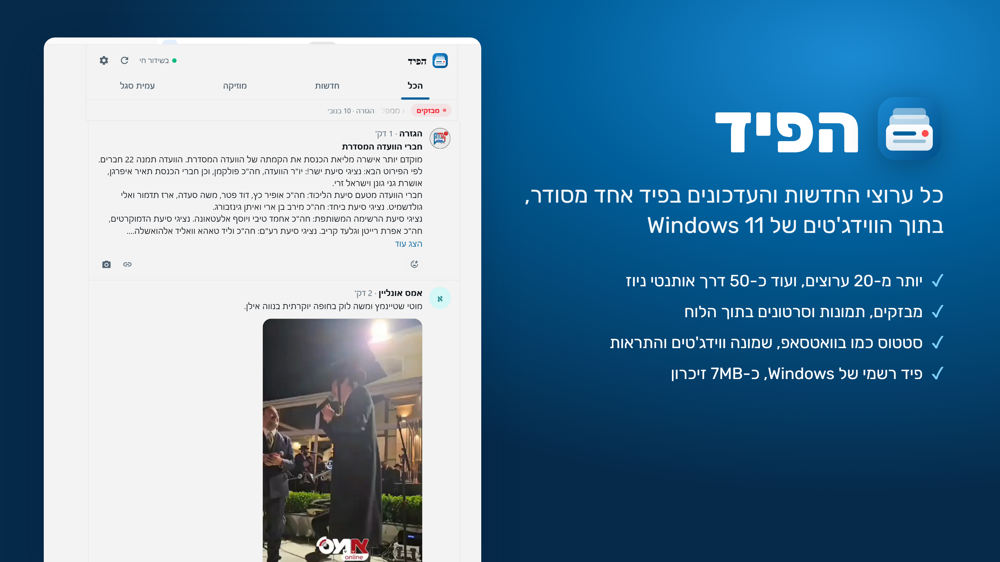
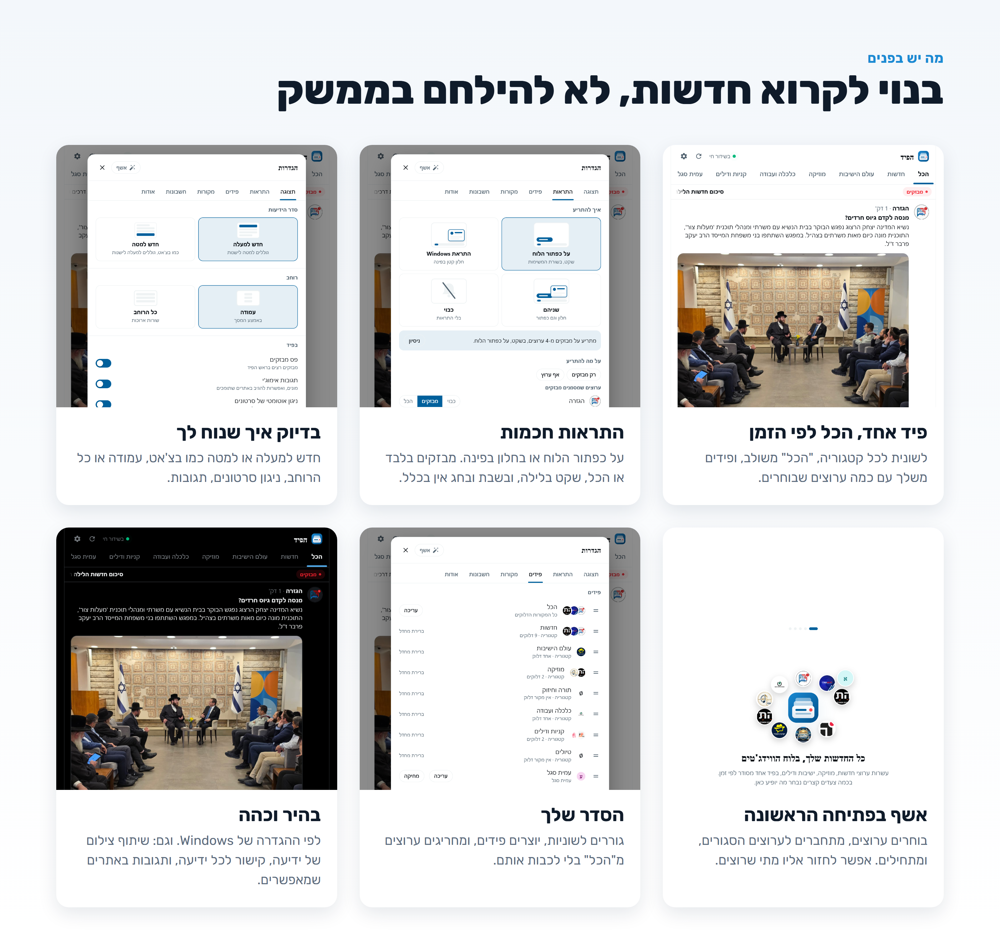
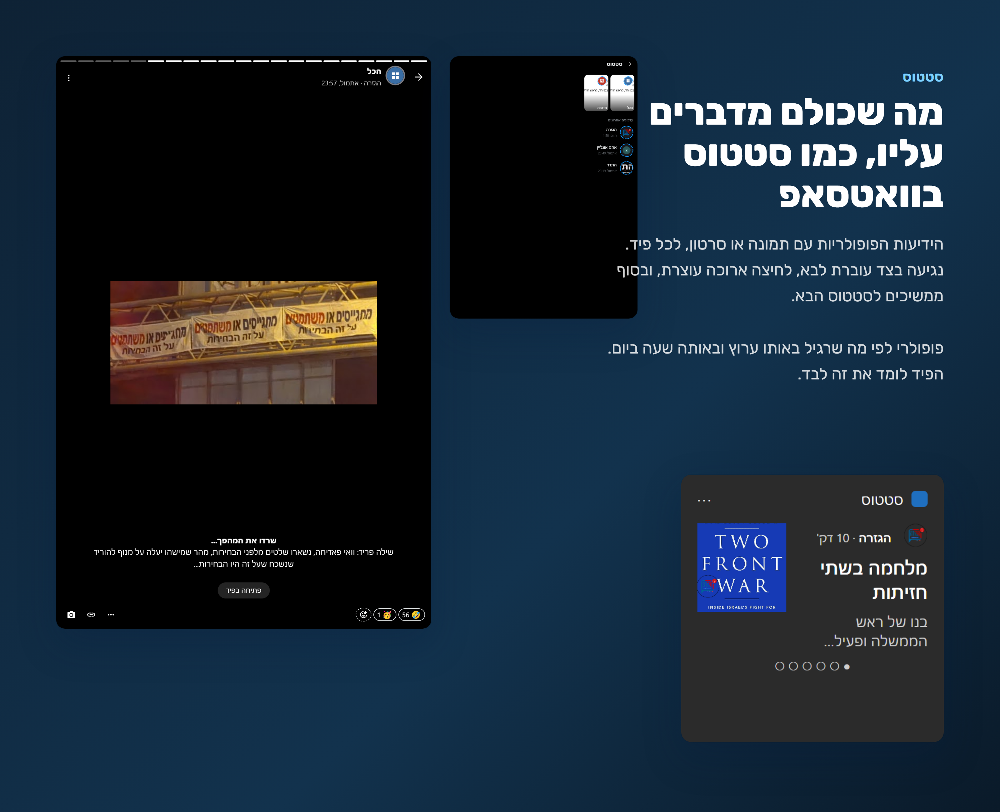
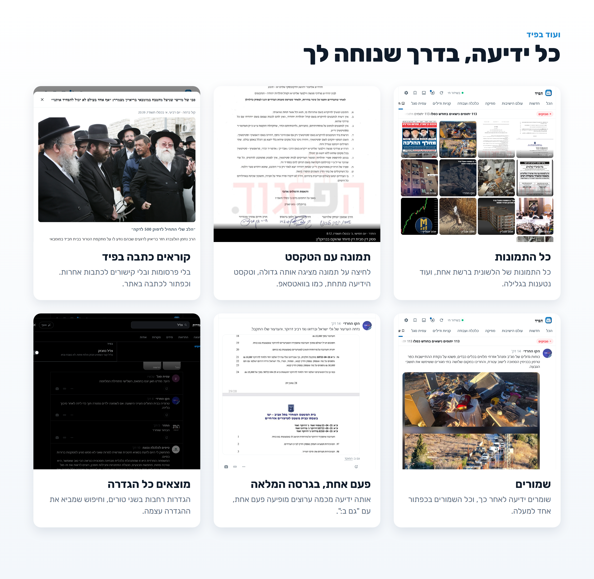
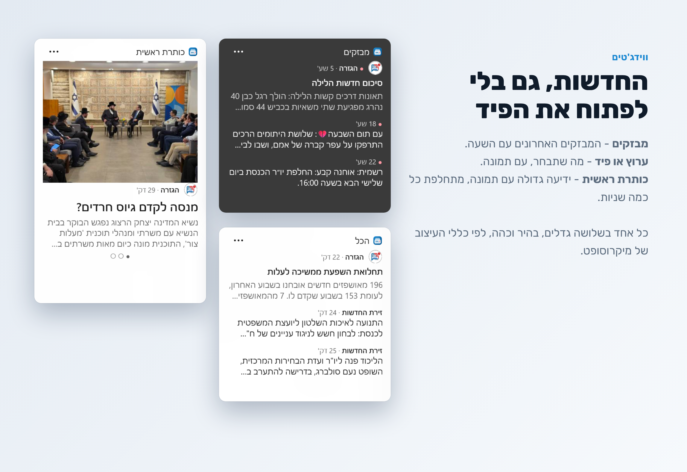
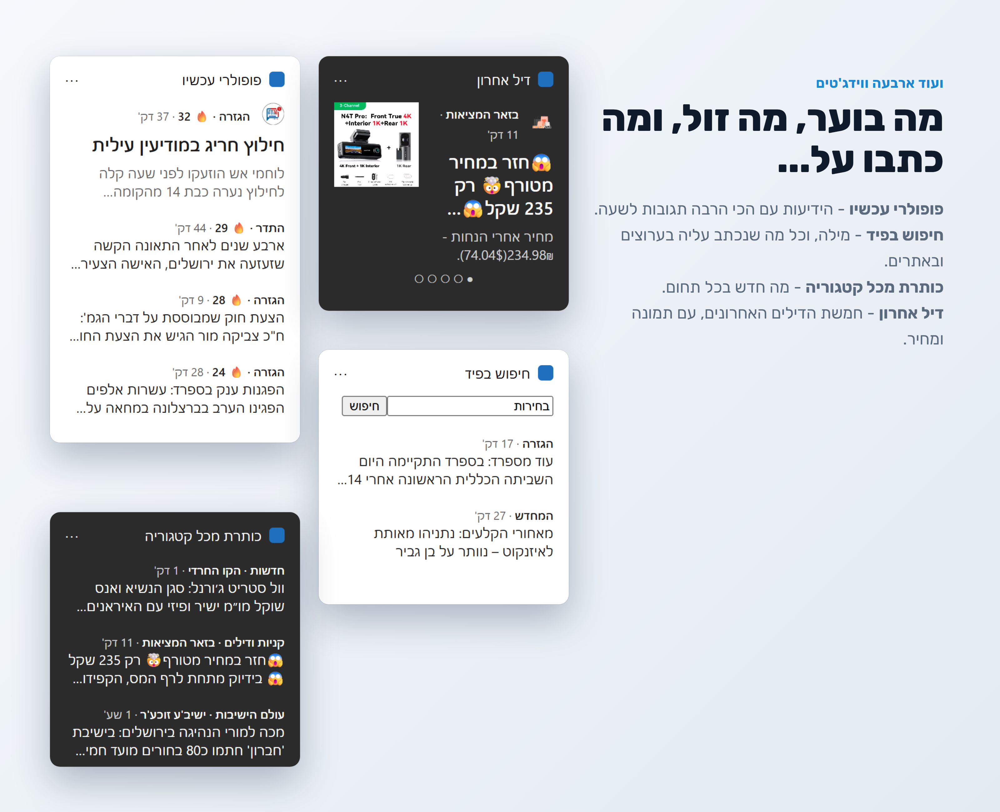
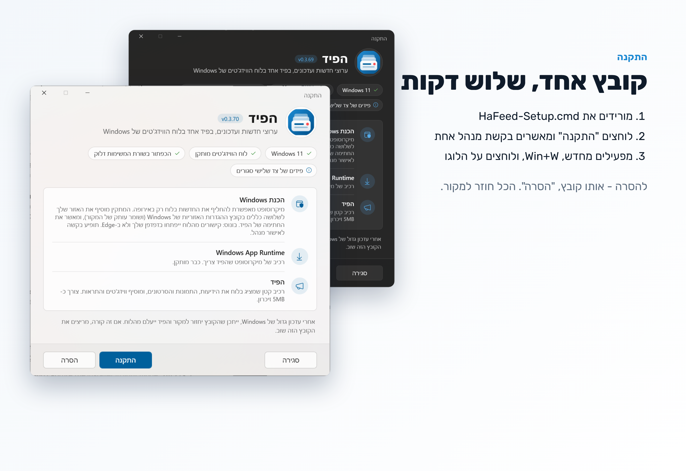

# הפיד

פיד חדשות ועדכונים מערוצים ישראליים, בתוך לוח הווידג'טים של Windows 11, עם ווידג'טים והתראות. נבנה על ה-API הרשמי של Windows App SDK (Feed Provider ו-Widget Provider).

## תכונות

- 25 ערוצים בשמונה קטגוריות, ועוד כ-50 ערוצים דרך אותנטי ניוז ו-11 ערוצים של אמס (כל ערוץ באפליקציה של אמס הוא מקור, בקטגוריה שלו, בקבוצה אחת עם מתג לכל אמס, שמכבה את כולם בלי לשנות את המתגים של כל ערוץ; עם שם הכתב). קטגוריית כתבות: JDN, כל רגע, המחדש, אמס, קול ברמה (RSS ו-WordPress REST). ערוצים סגורים: התחברות Google בחלון של האתר (עוגיות, או טוקן מ-localStorage של האתר).
- פיד אחד לפי זמן: לשונית לכל קטגוריה, לשונית "הכל" (עם החרגות, או כבויה), ופידים מותאמים.
- פס מבזקים, תמונות, סרטונים ושמע בתוך הלוח. ניגון אוטומטי (מושתק כברירת מחדל). סרטון מראה פריים ראשון לפני הניגון. שמע ממשיך לנגן במעבר לשונית, והכפתור מראה את המצב שלו.
- סדר חדש-למעלה או חדש-למטה, עמודה או כל הרוחב, זכירת מיקום. בחדש-למטה אזור הגלילה רגיל ורק הרשימה הפוכה, כך ש-Chromium מחזיק את מקום הקריאה (scroll anchoring) כמו בחדש-למעלה; לא column-reverse על אזור הגלילה.
- שלושה גדלי טקסט, צפיפות (מרווח / רגיל / צפוף, בצפוף תמונה קטנה בצד), צבעים אוטומטי / בהיר / כהה.
- השתקת ערוץ לזמן קצוב מתפריט הידיעה. הסתרת ידיעות לפי מילים. פרסומות מוסתרות כברירת מחדל.
- קישור לכל ידיעה באתר המקור, העתקת קישור, העתקת צילום של ידיעה, העתקת קובץ סרטון.
- תגובות אימוג'י באתרים שתומכים בהן.
- ניקוי חתימות ומשפטים קבועים, לכל ערוץ.
- ידיעה שנערכה: "נערך" ליד השעה, ולחיצה מציגה את כל הגרסאות שהפיד ראה.
- ערוץ שלא עונה 3 סבבים: נקודה אדומה על הסמל ושורה בהגדרות. בלי חיבור בכלל: שורה בראש הפיד, והפיד מציג מה שנשמר. כרטיסייה לא מחכה לערוץ איטי יותר מ-5 שניות; הוא נכנס למקומו כשהוא עונה.
- תמונה או סרטון שלא אפשר להציג: הודעה על הידיעה (למשל תמונה מ-Gmail או Google Chat של מי שפרסם).
- סטטוס בסגנון וואטסאפ: ידיעות פופולריות עם תמונה או סרטון מ-12 השעות האחרונות, לכל פיד (לשונית), בשורת ריבועים בראש הפיד (אפשר לכבות) ובמסך "סטטוס" עם שורה לכל ערוץ. מעבר בנגיעה, עצירה בלחיצה ארוכה, השתקה. "פופולרי": תגובות מעל הממוצע הנע של הערוץ, מתוקן לפי משקל שעה ביום שנלמד מהנתונים (ברירת מחדל: פי 1.2, ולפחות 2 תגובות).
- שמורים (localStorage), רשת תמונות של לשונית, תמונה מוגדלת עם טקסט הידיעה.
- קריאת כתבה בפיד: הדף מהאתר דרך הספק, מנוקה לטקסט ותמונות (בלי פרסומות וכרטיסי כתבות אחרות). אמס דרך WordPress REST.
- איחוד ידיעות כפולות מערוצים שונים (חפיפת מילים), הגרסה המלאה נשארת עם "גם ב:".
- תאריך עברי (או לועזי), חמישה גופנים (Google Fonts), 12 צבעי הדגשה או צבע Windows, טקסט בלבד (לכל הערוצים או לפי ערוץ), מילים מודגשות, קיצורי מקלדת.
- חיסכון בנתונים: אוטומטי בחיבור מדוד (לפי Windows), תמיד או כבוי. בזמן חיסכון: בלי עבודה ברקע, סרטונים רק בלחיצה (עם פריים אחד לתצוגה), בלי סטטוס, אפשר גם בלי תמונות, ובדיקה כל דקה או 5 דקות.
- ווידג'טים, שלושה גדלים, בהיר וכהה:
  - **מבזקים** - רשימת המבזקים של הגזרה.
  - **ערוץ או פיד** - ההודעות האחרונות מערוץ, קטגוריה, "הכל" או פיד מותאם, לפי בחירה בהתאמה האישית של הווידג'ט.
  - **כותרת ראשית** - כתבות עם תמונה מ-JDN, כל רגע, המחדש, אמס וקול ברמה (RSS ו-WordPress REST), ארבע מכל אתר, מתחלפת כל 15 שניות. אפשר לבחור אתר אחד.
  - **פופולרי עכשיו** - דירוג לפי תגובות לשעה מאז הפרסום, ב-24 השעות האחרונות.
  - **חיפוש בפיד** - Input.Text עם Action.Execute; חיפוש בשלושה עמודים של כל ערוץ דלוק ובכתבות של האתרים.
  - **כותרת מכל קטגוריה** - הידיעה האחרונה בכל קטגוריה, לפי עדכניות.
  - **דיל אחרון** - חמשת הדילים האחרונים עם תמונה, מתחלפים כל 15 שניות.
  - **סטטוס** - הסטטוסים הפופולריים עם תמונה, מתחלפים. לחיצה פותחת את הסטטוס בפיד.
- התראות: על כפתור הלוח, הודעת Windows, או שניהם. לכל ערוץ: כבוי / מבזקים / הכל. שקט בלילה, איחוד הצפות, מילות מפתח. אין התראות בשבת ובחג (זמני ירושלים). התראה על כפתור הלוח נעלמת אחרי 10 דקות.
- עדכון אוטומטי מ-GitHub Releases: ברקע בלי חלון, מ"אודות" עם חלון התקדמות קטן. עדכון שנכשל או לא הסתיים תוך 3 דקות מדווח ב"אודות".
- הגדרות: חלון רחב בשני טורים, חיפוש בכל הלשוניות, איפוס לכל לשונית עם ביטול. התחברות בשורת הערוץ.
- הגדרות מתקדמות: קצב רענון (ברירת מחדל 15 שניות), גיבוי ושחזור לקובץ (`Documents\HaFeed-backup-*.json`, בלי ההתחברויות), ניקוי זיכרון, איפוס.
- אודות: "מה חדש" מכל ה-Releases, מונה ההורדות של GitHub, ודיווח על בעיה (GitHub Issue מוכן עם גרסה, Windows ויומן), או העתקת אותם פרטים כטקסט להדבקה בפורום או בהודעה.
- אשף בפתיחה הראשונה: ערוצים, התחברות, התראות, תצוגה (סדר, מבזקים, סטטוס, צבע), והוספת ווידג'טים. אחריו סיור קצר בכפתורים. בהיר וכהה לפי Windows.

## דרישות

- Windows 11 22H2 (build 22621) ומעלה, עם לוח הווידג'טים.
- Windows App Runtime 1.6. המתקין מוריד אותו ממיקרוסופט אם חסר.
- הרשאת מנהל פעם אחת, בהתקנה.

## התקנה, עדכון והסרה

1. מורידים את `HaFeed-Setup.cmd` מ-[Releases](https://github.com/The-Young-boy/HaFeed/releases/latest).
2. מריצים, "התקנה", "המשך" במסך ההסבר, ומאשרים את בקשת המנהל.

המתקין מעתיק את עצמו ל-`%LOCALAPPDATA%\HagizraFeed\setup.ps1` ומריץ אותו עם `-File` (בלי `iex`, שאנטי וירוס חוסם). הקבצים הזמניים בנתיב המלא של התיקייה (שם משתמש בעברית נותן ל-`%TEMP%` שם מקוצר).
3. מפעילים מחדש. Win+W, ולוחצים על הלוגו של הפיד בסרגל הצד.

אם יש ב-Releases גרסה חדשה יותר מזו שבקובץ, המתקין מציין את זה, מוריד ומתקין אותה.

התקנה בלי ממשק: `HaFeed-Setup.cmd /quiet`. קוד יציאה 0 = הותקן, 3010 = הותקן ונדרשת הפעלה מחדש, 1 = נכשל (פרטים ב-`%ProgramData%\HagizraFeed\setup.log`).

**עדכונים:** הפיד בודק את ה-Release האחרון שתי דקות אחרי שהוא עולה, ואחר כך כל 6 שעות. גרסה חדשה מותקנת ברקע. אפשר לכבות ב"אודות".

**הסרה:** מריצים את אותו קובץ, "הסרה". החבילה והתעודה נמחקות, וקובץ המדיניות חוזר למקור.

אחרי עדכון גדול של Windows, קובץ המדיניות עלול לחזור למקור. אז מריצים את המתקין שוב.

## איך זה עובד

**הרשאה אזורית.** Windows פותח פידים של צד שלישי בלוח רק באזור EEA. ההגדרה נמצאת ב-`C:\Windows\System32\IntegratedServicesRegionPolicySet.json`. המתקין מוסיף את קוד האזור של המחשב לשלושה כללים: פיד צד שלישי, כיבוי הפיד של מיקרוסופט, ופתיחת קישורים בדפדפן ברירת המחדל. עותק המקור נשמר ב-`.orig`. אין שינוי ב-hosts, אין תעודת Root, ואין שרת מקומי.

**החבילה.** MSIX חתום בתעודה עצמית. התעודה נכנסת ל-`LocalMachine\TrustedPeople` בלבד, כי Windows לא מתקין חבילה לא חתומה שמריצה exe.

**הספק.** `hagizra-widget.exe` הוא שרת COM מחוץ לתהליך (Rust, כ-650KB), שרושם שתי מחלקות:
- **Feed Provider.** הלוח טוען את `https://hagizra.news/winfeed/` ומנתב את הבקשות ל-`OnResourceRequested` (לפי `WebRequestFilter`). הספק מחזיר את הדף מתוך ה-exe, ומשרת עבורו נתיבי `/winfeed/*`: proxy לאתרי הערוצים (WinHTTP, כי הדף לא יכול לקרוא מקורות אחרים), התחברות, התראות, פתיחת קישורים, ועדכונים. הלוח מחכה לכל תשובה של הספק, ולכן ה-proxy לא מחכה לאתר: בקשת קריאה (GET, או POST עם `c=1`) מקבלת מיד את התשובה האחרונה, ותשובה חדשה נטענת ברקע (`http::cached`). בטעינה הראשונה הוא עונה 425 והדף שואל שוב.
- **Widget Provider.** כרטיסי Adaptive Cards שנבנים ב-`widgets.rs`. הדף טוען את הידיעות ושולח אותן לספק (`/winfeed/widgets/need` ו-`push`). הספק מעדכן את הכרטיסים, ומסובב את הכותרת הראשית כל 15 שניות. התמונות עוברות דרך הדף: הוא ממיר WEBP ו-SVG ל-PNG או JPEG, ומהפך מראש תמונות רקע (הלוח מציג אותן במראה בממשק מימין לשמאל). תמונה שנטפרי עדיין בודק מוחלפת אחרי 15 דקות.

**הדף.** `feed.html` הוא כל הממשק, בקובץ אחד. הלוח משאיר אותו פעיל גם כשהלוח סגור, ולכן ההתראות והווידג'טים נטענים ממנו. ההגדרות נשמרות ב-localStorage של הלוח.

**התחברות לערוצים סגורים.** חלון Edge `--app` עם פרופיל נפרד, ואחר כך Edge headless על אותו פרופיל קורא את העוגיות דרך DevTools Protocol. העוגיות נשמרות מוצפנות ב-DPAPI ב-`%LOCALAPPDATA%\HagizraFeed\cookies.dat`. ערוץ ששומר את ההתחברות כטוקן ב-localStorage (צ'ארלי גולגולת): הטוקן נקרא מהדף דרך DevTools (`Runtime.evaluate`), והספק מוסיף אותו לגוף הבקשות ל-API שלו.

**התראות.** הודעת Windows (ToastNotification), או FeedAnnouncement על כפתור הלוח.

**עדכונים.** הספק קורא את `releases/latest` ב-GitHub API, ומוריד את `HaFeed.msix`. ההתקנה רצה ממשימת Task Scheduler חד-פעמית, כי חבילה לא יכולה להחליף את עצמה מתוך התהליכים שלה. Windows מקבל את החבילה רק אם היא חתומה באותה תעודה.

## פרטיות

- אין שרת של הפרויקט. הבקשות יוצאות מהמחשב ישירות לאתרי הערוצים, ול-GitHub לבדיקת עדכונים.
- אין חשבון, אין מעקב ואין טלמטריה.
- ההגדרות, השמורים והנצפים נשמרים במחשב בלבד. מונה ההורדות הוא של GitHub; אין ספירת התקנות.
- ההתחברויות נשמרות מוצפנות ב-DPAPI, ו"התנתקות" מוחקת אותן.

## מבנה הקוד

| קובץ | תפקיד |
|---|---|
| `src/main.rs` | שרת COM, Feed Provider, נתיבי `/winfeed/*` |
| `src/feed.html` | הממשק: פיד, הגדרות, אשף, התראות, טעינת הווידג'טים |
| `src/widgets.rs` | Widget Provider וכרטיסי Adaptive Cards |
| `src/http.rs` | WinHTTP: בקשות, הורדה, WebSocket |
| `src/login.rs` | התחברות Google דרך Edge (עוגיות או טוקן), אחסון DPAPI |
| `src/notify.rs` | ToastNotification ו-FeedAnnouncement |
| `src/update.rs` | בדיקת עדכונים והתקנה |
| `src/update-window.ps1` | חלון ההתקדמות של עדכון מ"אודות" |
| `src/clip.rs` | העתקת סרטון כקובץ |
| `src/bindings.rs` | נוצר מ-`winmd/` על ידי `tools/gen` |
| `dist/Setup.template.cmd` | המתקין: CMD אחד עם ממשק WPF |
| `sources/` | תיעוד ה-API של כל ערוץ |

## בנייה

דרוש: Rust, Windows SDK (makeappx, signtool), Windows App Runtime 1.6.

- `tools/deploy.ps1` - בנייה ורישום ישיר של המניפסט, לפיתוח.
- `tools/build-dist.ps1` (PowerShell 7) - בונה את `dist\out\HaFeed-Setup.cmd` ואת `dist\out\HaFeed.msix`. כל Release צריך את שני הקבצים.
- `node tools/dev-server.mjs` - הדף בדפדפן רגיל, ב-http://localhost:5178/winfeed/
- `hagizra-widget.exe --cards <file>`, ואז http://localhost:5178/widgets - תצוגה של כל הווידג'טים בכל הגדלים.
- `cargo run --manifest-path tools/gen/Cargo.toml` - יוצר מחדש את `src/bindings.rs`.
- `cargo test --release` - בדיקות. `cargo test --release github -- --ignored` - בדיקה מול GitHub.

## מקורות התוכן

התוכן שייך לערוצים. הפיד מציג אותו עם קישור לכל ידיעה באתר המקור.

הגזרה, הקו החרדי, המשבק, התדר, אמס אונליין, מבזקי המחדש, כל רגע, מיין שמש, המוקד, זירת החדשות, ישיב'ע זוכע'ר, שטייגען, כותל המזרח, התדר מיוזיק, מיוזיק אונליין, מוזיקה אקספרס, ידיד נפש, טיפים לכלכלה נכונה, עבודות איכות לחרדים, בזאר המציאות, My ali, My ali מותגים מוסתרים, מעיינות ונחלים נדירים, החתול השחור, צ'ארלי גולגולת, ואותנטי ניוז.

הכתבות בווידג'ט "כותרת ראשית": JDN, כל רגע, המחדש, אמס, קול ברמה.

## רכיבים של צד שלישי

- [Windows App SDK](https://github.com/microsoft/WindowsAppSDK) ו-[windows-rs](https://github.com/microsoft/windows-rs) - מיקרוסופט.
- [Adaptive Cards](https://adaptivecards.io) - מיקרוסופט. קבצי ה-host config ב-`tools/widget-preview`.
- [Noto Emoji](https://github.com/googlefonts/noto-emoji) - Google, נטען מ-fonts.gstatic.com.
- היבו, אסיסטנט, רוביק ופרנק רוהל - [Google Fonts](https://fonts.google.com), נטענים רק כשבוחרים בהם.
- [serde_json](https://github.com/serde-rs/json).

## רישיון

GPL-3.0. ראו `LICENSE`.
