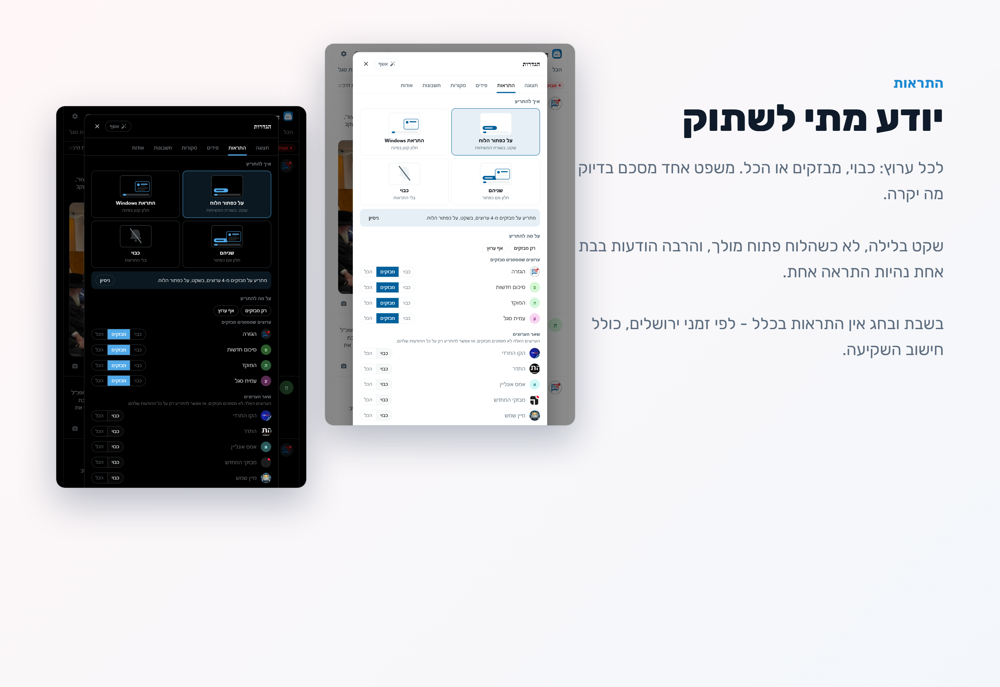
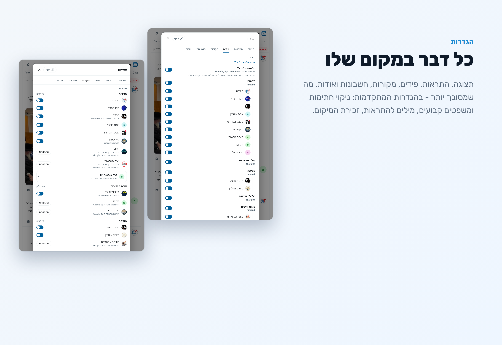
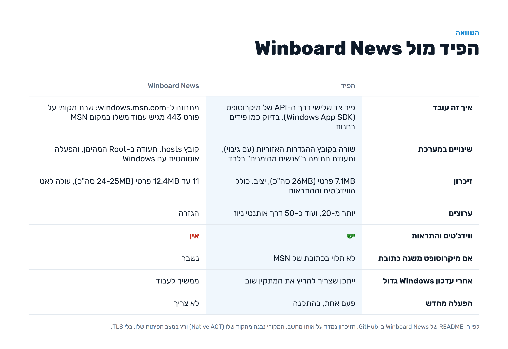

# הפיד - כל ערוצי החדשות בלוח הווידג'טים של Windows 11

לפני כמה זמן ראיתי פה את Winboard News של Y-PLONI (אחלה רעיון!), התקנתי, ו... אצלי זה לא עבד. אז ישבתי עם ה-AI לבדוק למה, ובקיצור - יצא כלי אחר לגמרי. התחיל כ"הגזרה בלוח", ובדרך נהיה פיד של כל הערוצים.

**מה זה?** לוח נפרד בתוך הווידג'טים (Win+W), עם הערוצים שאתם בוחרים בפיד אחד מסודר לפי זמן. גלילה בלי סוף, תמונות וסרטונים בתוך הידיעה, מבזקים בפס למעלה, ווידג'טים, התראות. מתעדכן לבד. ואת "גלה" של MSN אפשר לכבות במתג רשמי של הלוח.

## מה יש בפנים

**ערוצים.** 22 ערוצים מסודרים לפי קטגוריות, ועוד כ-50 ערוצים של אותנטי ניוז:

- **חדשות:** הגזרה, הקו החרדי, התדר, אמס אונליין, מבזקי המחדש, מיין שמש, המוקד, זירת החדשות
- **עולם הישיבות:** ישיב'ע זוכע'ר, שטייגען, כותל המזרח
- **מוזיקה:** התדר מיוזיק, מיוזיק אונליין, מוזיקה אקספרס
- **תורה וחיזוק:** ידיד נפש
- **כלכלה ועבודה:** טיפים לכלכלה נכונה, עבודות איכות לחרדים
- **קניות ודילים:** בזאר המציאות, My ali, My ali מותגים מוסתרים
- **טיולים:** מעיינות ונחלים נדירים
- **הומור ובידור:** החתול השחור

חלק מהערוצים פתוחים רק למי שמחובר עם Google. בשבילם נפתח חלון קטן של האתר עצמו, מתחברים, סוגרים, וזהו. ההתחברות נשמרת רק במחשב שלכם, מוצפנת.

**הפיד עצמו:**
- לשונית לכל קטגוריה, ולשונית "הכל" שמשלבת הכל. אפשר להחריג ממנה ערוצים או קטגוריות בלי לכבות אותם, או לכבות אותה לגמרי.
- פידים משלכם: בוחרים כמה ערוצים, נותנים שם, מקבלים לשונית.
- סדר הלשוניות בגרירה.
- חדש למעלה, או חדש למטה כמו בצ'אט.
- זוכר איפה עצרתם. חוזרים תוך חצי דקה? הפיד נשאר במקום.
- סרטונים מתנגנים לבד כשהם על המסך (מושתק, אפשר לשנות).
- לחיצה על שם הערוץ פותחת את הידיעה באתר המקור. כפתור הקישור מעתיק את הקישור.
- כפתור המצלמה מעתיק צילום של הידיעה, להדבקה בוואטסאפ או במייל. בסרטון יש גם כפתור שמעתיק את קובץ הסרטון.
- תגובות אימוג'י, באתרים שמאפשרים.
- בהיר וכהה, לפי Windows.
- ניקוי חתימות: המשפטים הקבועים שחלק מהערוצים מדביקים בסוף כל ידיעה ("ניתן לשלוח ידיעות...", "אהבתם? שימו לייק") נמחקים. אפשר להוסיף משפטים משלכם.

### ווידג'טים

שלושה ווידג'טים, כל אחד בשלושה גדלים:
- **מבזקים** - המבזקים האחרונים, עם השעה.
- **ערוץ או פיד** - מה שבוחרים בתפריט של הווידג'ט.
- **כותרת ראשית** - ידיעה גדולה עם תמונה, מתחלפת כל 15 שניות. לחיצה עליה מקפיצה את הפיד בדיוק לידיעה הזאת.

מוסיפים מה-+ של הלוח, תחת "הפיד".

### התראות

בוחרים איך: על כפתור הלוח בשורת המשימות (בשקט, זאת ברירת המחדל), חלון בפינת המסך, או שניהם. ולכל ערוץ: כבוי, רק מבזקים, או הכל.

כללים: שקט בלילה, לא כשהלוח פתוח מולכם, והרבה הודעות בבת אחת נהיות התראה אחת. ובמתקדם: רק הודעות עם מילים מסוימות, או אף פעם לא.

**בשבת ובחג אין התראות.** זה לא ניתן לשינוי. לפי זמני ירושלים, מ-40 דקות לפני השקיעה ועד 50 דקות אחרי, כולל ימים טובים.

"מבזקים" מופיע רק בערוצים שבאמת מסמנים מבזקים. בדקתי את כולם: כרגע זה הגזרה (ואותנטי, שיש לו את השדה אבל הוא עוד לא בשימוש). בשאר הערוצים אפשר רק "הכל" או "כבוי".

### הגדרות

תצוגה, התראות, פידים, מקורות, חשבונות ואודות. ובפתיחה הראשונה עולה אשף קצר שבוחר ערוץ אחד מכל קטגוריה, ואפשר לחזור אליו מתי שרוצים.

## איך זה עובד

מיקרוסופט מאפשרת לכל אחד לבנות פיד ללוח (Feed Provider, חלק מה-Windows App SDK). הבעיה: הם פותחים את זה רק באירופה (EEA). בישראל הלוח פשוט מתעלם מפידים כאלה.

ההגבלה הזאת יושבת בקובץ אחד: `C:\Windows\System32\IntegratedServicesRegionPolicySet.json`. יש בו רשימת מדינות לכל פיצ'ר. המתקין מוסיף את האזור של המחשב לשלושה כללים בלבד:
- פיד של צד שלישי בלוח.
- אפשרות לכבות את הפיד של מיקרוסופט.
- קישורים מהלוח נפתחים בדפדפן ברירת המחדל ולא ב-Edge.

זהו. לא נוגעים ב-hosts, לא מתחזים לשום אתר, ואין שרת שלי באמצע. הפיד הוא exe קטן ב-Rust (כ-650KB). Windows מריץ אותו ומחזיק אותו חי כל עוד הפיד דלוק. הבקשות יוצאות מהמחשב שלכם ישר לאתרים של הערוצים.

## השוואה

**זיכרון.** מדדתי על אותו מחשב. הפיד: 7.1MB פרטי (26MB סה"כ), יציב, וזה כבר כולל את הווידג'טים וההתראות. Winboard News: 11 עד 12.4MB פרטי (24-25MB סה"כ), עולה לאט בכל רענון. את המקורי בניתי מהקוד שלו (Native AOT, כמו ב-Release) והרצתי במצב הפיתוח שלו, בלי TLS. ה-"סה"כ" כולל DLL-ים של Windows שמשותפים לכל המחשב, אז המספר החשוב הוא הפרטי. העמוד עצמו נטען בכל מקרה בתוך הלוח, אצל שניהם, ולא נכלל פה.

בקצרה: Winboard מחליף את MSN בכוח, מבחוץ. זה עובד בלי הפעלה מחדש, אבל זה פרוקסי שרץ כל הזמן, עם תעודה ב-Root, ונשבר אם מיקרוסופט משנה כתובת. אצלי זה פיד רשמי, אבל צריך להוסיף שורה בקובץ מערכת, ואחרי עדכון גדול של Windows ייתכן שהקובץ יחזור למקור (מריצים את המתקין שוב, וזהו).

כל אחד יבחר מה שמתאים לו. אין פה מלחמה, הרעיון המקורי שלו 👍

## התקנה

1. מורידים את `HaFeed-Setup.cmd` (קובץ אחד, כ-1MB) מ-[Releases](https://github.com/The-Young-boy/HaFeed/releases/latest).
2. פותחים, לוחצים "התקנה", ומאשרים בקשת מנהל אחת.
3. מפעילים מחדש את המחשב. Win+W, ולוחצים על הלוגו של הפיד בסרגל הצד. האשף עושה את השאר.

אם Windows מזהיר על הקובץ - "מידע נוסף" ואז "הפעל בכל זאת". (אין לי כח לשלם על תעודה מסחרית...)

מה המתקין עושה, בשביל מי שרוצה לדעת:
- משנה את שלוש השורות בקובץ האזורי. עותק של המקור נשמר לידו (`.orig`).
- מוסיף את תעודת החתימה של החבילה ל"אנשים מהימנים" (TrustedPeople) של המחשב. לא ל-Root. Windows פשוט לא מתקין חבילה לא חתומה שמריצה exe.
- מתקין את Windows App Runtime 1.6, ישירות ממיקרוסופט, רק אם חסר.
- בודק שכפתור הווידג'טים בשורת המשימות דלוק.
- מתקין את הפיד.

**עדכונים:** הפיד בודק ב-GitHub פעם בכמה שעות, ומתעדכן לבד ברקע (אפשר לכבות ב"אודות"). וגם המתקין, אם יש ב-GitHub גרסה חדשה יותר ממה שבתוכו, מוריד ומתקין אותה.

**הסרה:** מריצים את אותו קובץ, "הסרה". זה מוחק את החבילה והתעודה, ומחזיר את הקובץ המקורי.

**דרישות:** Windows 11 22H2 ומעלה, עם לוח הווידג'טים.

**נטפרי:** בדקתי מול נטפרי, וכל הערוצים פתוחים. הפיד משתמש בתעודות של Windows, אז התעודה של נטפרי עובדת לבד, והכל עובר בסינון הרגיל.

## פרטיות

- אין לי שרת. אין חשבון, אין מעקב, אין סטטיסטיקות.
- ההגדרות נשמרות רק במחשב שלכם.
- ההתחברויות לערוצים הסגורים נשמרות מוצפנות (DPAPI של Windows, רק המשתמש שלכם יכול לקרוא). "התנתקות" מוחקת אותן.
- כשאתם מגיבים באתר, התגובה נשלחת לאתר של הערוץ, כמו מהדפדפן.

## קוד פתוח

כל הקוד כאן, ברישיון GPL-3.0. הפוסט בפורום מתמחים: https://mitmachim.top/post/1284708

## למפתחים

| | |
|---|---|
| `src/main.rs` | שרת COM (Feed Provider + Widget Provider), ונתיבי `/winfeed/*` שהדף קורא להם |
| `src/feed.html` | כל הממשק: הפיד, ההגדרות, האשף, ההתראות, והטעינה בשביל הווידג'טים |
| `src/widgets.rs` | הווידג'טים (Adaptive Cards) |
| `src/http.rs`, `src/login.rs` | WinHTTP, והתחברות Google דרך חלון Edge (העוגיות נשמרות ב-DPAPI) |
| `src/notify.rs`, `src/clip.rs` | התראות, והעתקת סרטון כקובץ |
| `dist/Setup.template.cmd` | המתקין (CMD אחד עם ממשק WPF) |
| `sources/` | התיעוד של כל ערוץ: נקודות קצה, תגובות, מבזקים |

**בנייה:** Rust, Windows SDK (בשביל makeappx ו-signtool), ו-Windows App Runtime 1.6.
- `tools/deploy.ps1` - בנייה והתקנה למפתחים (רישום ישיר של המניפסט).
- `tools/build-dist.ps1` - בונה את `dist\out\HaFeed-Setup.cmd`, חתום בתעודה עצמית.
- `node tools/dev-server.mjs` - הדף בדפדפן רגיל, בלי הלוח, על http://localhost:5178/winfeed/
- `hagizra-widget.exe --cards <file>` ואז http://localhost:5178/widgets - כל הווידג'טים בכל הגדלים.
- `cargo run --manifest-path tools/gen/Cargo.toml` - יוצר מחדש את `src/bindings.rs` מה-winmd.

## קרדיטים ומקורות

- **הערוצים** - כל התוכן שלהם. הפיד רק מציג אותו, ובכל ידיעה יש קישור לאתר המקור:
  הגזרה (hagizra.news), הקו החרדי (hakavhacharedi.com), התדר (hateder.net), אמס (emess.co.il), המחדש (hm-news.co.il), מיין שמש (myshemesh.co.il), המוקד (h-news.co.il), זירת החדשות (zirat.news), ישיב'ע זוכע'ר, שטייגען, כותל המזרח, מיוזיק אונליין (musiconline.co.il), מוזיקה אקספרס, ידיד נפש (yedid-nefesh.com), טיפים לכלכלה נכונה, עבודות איכות לחרדים, בזאר המציאות, My ali, מעיינות ונחלים נדירים - ישראל שפירא (israelshapira.com), החתול השחור.
- **אותנטי ניוז** (authenti.newsupdates.click) - עשרות הערוצים הנוספים.
- **Winboard News** של Y-PLONI - הרעיון, וההשראה.
- **מיקרוסופט** - Windows App SDK (פידים, ווידג'טים והודעות על כפתור הלוח), windows-rs (הגישה מ-Rust), ו-Adaptive Cards לעיצוב הווידג'טים.
- **Google** - האימוג'י (Noto Emoji).
- **serde_json** - קריאת JSON ב-Rust.
- **Claude** (של Anthropic) - כתב איתי את הקוד.

## גילוי נאות

- הקוד נכתב יחד עם AI. ההנדסה ההפוכה של הלוח הייתה לילה שלם... אבל זה עובד.
- בדקתי על המחשב שלי. לא לוקח אחריות. תבדקו ותעדכנו.
- אין לי קשר לאף אחד מהערוצים. התוכן שלהם, אני רק מציג אותו.

שאלות - בשמחה, עדיף בפרטי.

בהצלחה!
